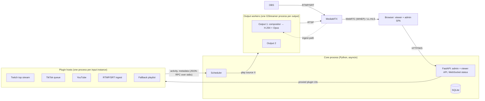

# Architecture

lan-streamer pulls media from pluggable **inputs**, lets a **scheduler** pick the most important active one, and plays it on one or more **outputs**: re-encoded 1080p live streams that a browser on the local network watches with sub-second latency.

Status: concept. Nothing here is implemented yet; see [roadmap.md](roadmap.md).

## At a glance



## Processes

| Process | Count | Does | Why separate |
| --- | --- | --- | --- |
| Core | 1 | Web API, scheduler, config in SQLite, supervises the other processes | Single source of truth |
| Plugin host | 1 per input instance | Runs one plugin: activity detection, source resolution, its own web routes | A broken plugin only takes itself down (F-IN-07, F-PLG-05) |
| Output worker | 1 per output | Runs one GStreamer pipeline with a permanently running encoder | A crashed pipeline is restarted without touching other outputs |
| MediaMTX | 1 (container) | Serves outputs via WebRTC and LL-HLS, accepts RTMP/SRT ingest, optional restream | Proven media server, no need to write one |

Core talks to plugin hosts and output workers over JSON-RPC on the child's stdin/stdout. This works the same on Windows and Linux. The core restarts a dead child with backoff and shows it as `error` in the admin UI.

### Outputs and input instances

Every input instance belongs to exactly one output. Two outputs that both show TikTok submissions have two instances, each with its own settings, queue and submit form. This keeps the outputs independent and the scheduler simple.

## Media pipeline (per output)

The hard requirement is F-SCH-03: switching inputs must never interrupt the output stream. The pipeline is therefore built so the encoder never sees a gap:

```
background layer (still image / black + silence, always running) ──┐
input slot A: fallbacksrc → decode → scale/rate 1920×1080@30 → loudnorm ─┼─► compositor + audiomixer ─► H.264 encoder ─► RTSP ─► MediaMTX
input slot B: (next input, prerolling)                                   ─┘                         Opus encoder ─┘
```

- **Make before break:** the next input starts in a free slot. Only when its first frame has arrived does the compositor fade it in (this gives F-SCH-05 transitions almost for free) and release the old slot.
- **Background layer:** if an input stalls, the compositor keeps producing frames from the background, so the stream stays up (NF-01) until the scheduler switches.
- **Robust sources:** `fallbacksrc` / `fallbackswitch` from gst-plugins-rs handle timeouts and reconnects of live sources.
- **Uniform output (NF-03):** every slot is scaled to 1080p30 and normalised to EBU R128 loudness (`audioloudnorm`).
- **Encoder:** H.264, no B-frames, 1 s GOP, tuned for low latency; see [Encoder selection](#encoder-selection).
- **Audio is Opus**, because browsers only accept Opus over WebRTC; MediaMTX also serves Opus over fMP4 LL-HLS. A restream to Twitch/YouTube (F-OUT-03) adds an AAC branch only while it is enabled.
- **Overlays (F-OUT-04):** first version draws source, title and submitter with GStreamer text/Cairo overlays. HTML overlays are a later option.

### Encoder selection

By default (`encoder = auto`) every output worker probes the available GStreamer encoders at startup and takes the first that works. It probes by encoding a few test frames, because an element can exist without a matching GPU or driver:

| Vendor | Windows | Linux |
| --- | --- | --- |
| NVIDIA | `nvh264enc` (NVENC) | `nvh264enc` (NVENC) |
| AMD | `amfh264enc` (AMF) | `vah264enc` (VA-API, Mesa) |
| Intel | `qsvh264enc` (Quick Sync) | `vah264enc` / `qsvh264enc` |
| CPU | `x264enc` | `x264enc` |

The admin can override this in the settings, globally and per output: `auto`, `nvidia`, `amd`, `intel` or `cpu`. If the chosen encoder fails, the output falls back to `cpu` and the admin UI shows a warning. The admin UI also shows which encoder each output actually uses.

### Media sources

A plugin resolves *what* to play; the output worker does the decoding. The plugin returns one of:

| Source | Example | Played via |
| --- | --- | --- |
| `UriSource(url, headers)` | Direct HLS/MP4 URL from yt-dlp | `fallbacksrc` |
| `PipeSource(argv)` | `streamlink --stdout twitch.tv/x best` (handles token refresh and ads) | Process stdout → `fdsrc` |
| `FileSource(path)` | Fallback playlist, downloaded TikTok clip | `filesrc` |
| `IngestSource(path)` | OBS stream arriving at MediaMTX | RTSP from MediaMTX |

## Scheduler

The scheduler is a pure, deterministic function, so it can be fully unit-tested with a fake clock (NF-08):

```
decide(output_config, input_states, current, now) -> Decision(keep | switch_to(instance) | fallback)
```

Rules, in order:

1. Admin overrides win: a forced input plays, a blocked input is ignored (F-AKT-05).
2. Among active inputs, the highest priority in this output's ranking wins (F-SCH-01).
3. A higher-priority input interrupts the current one immediately, even if the current one has not reached its minimum duration (F-SCH-04).
4. On equal priority, the current input keeps playing until its minimum duration is over and its plugin's `can_release()` returns true, or until its maximum duration is reached (F-SCH-04, F-AKT-04).
5. No active input: the fallback plays (F-SCH-02). The fallback input is always active with the lowest priority.

Plugins push activity changes as events. The core also polls every few seconds (F-AKT-02) and debounces flapping activity before acting on it.

## Plugin system

A plugin is a `.zip` with a manifest, uploaded in the admin UI (F-PLG-02):

```toml
# plugin.toml
id = "tiktok-queue"
name = "TikTok submissions"
version = "1.0.0"
api_version = 1                  # major version of the plugin API
entry = "tiktok_queue:Plugin"
requirements = ["yt-dlp>=2026.1"]
```

On upload the core checks `api_version` and rejects incompatible plugins with a clear message (F-PLG-04). It then installs the requirements into a virtualenv for that plugin, so plugins cannot break each other's dependencies.

Plugin authors depend only on the small `lanstreamer-sdk` package. It holds the base class, the source types, the context object and a test harness. The plugin API, refined from the requirements sketch:

```python
class InputPlugin(Generic[S]):
    Settings: type[S]                       # Pydantic model → admin form (F-IN-03)

    def __init__(self, ctx: PluginContext, settings: S): ...

    async def watch_active(self) -> AsyncIterator[bool]: ...   # F-AKT-01/02
    async def get_source(self) -> MediaSource: ...             # F-IN-01
    async def can_release(self) -> bool: ...                   # equal-priority handover
    async def on_playback(self, event: PlaybackEvent) -> None: ...  # started / ended / failed
    def routes(self) -> APIRouter | None: ...                  # own UI (F-IN-04)
```

- `PluginContext` gives each instance a key-value store, an HTTP client, a logger and a way to publish metadata such as title, channel and thumbnail (F-IN-06, F-PLG-06).
- `on_playback` closes the loop for queue-style inputs: the TikTok plugin learns that a clip has ended, pops its queue and can release.
- `routes()` keeps the sketch's FastAPI router, but it runs inside the plugin host on a random loopback port. The core reverse-proxies `/p/<instance>/…` to it, and the viewer page embeds it in an iframe (F-WEB-03).

**Security note:** isolation means fault isolation, not a sandbox. An uploaded plugin runs arbitrary code. Only an admin may install plugins, and the whole system is meant for the local network or a VPN (NF-06).

## Web UI

- SvelteKit, built as a static single-page app and served by FastAPI.
- **Viewer page** (no login, LAN only): one player per output, WebRTC via WHEP, falling back to hls.js. It shows what is playing and embeds the plugin UIs.
- **Admin area** (login, one admin account, Argon2 password hash, session cookie): outputs, input instances, rankings, overrides, plugin upload, live status over WebSocket, and logs per input and output.
- Settings forms are generated from each plugin's Pydantic JSON Schema.

## Installation and packaging

lan-streamer runs natively on Windows and Linux, so it can be developed and run on either system. Every release builds both installers in GitHub Actions. Each installer brings everything with it: a standalone Python runtime, the app and its dependencies, GStreamer and MediaMTX.

| System | Format | Runs as |
| --- | --- | --- |
| Windows 10/11 x64 | Setup `.exe` (Inno Setup) with the official GStreamer MSVC runtime | Windows service; the installer adds firewall rules for the LAN |
| Linux x64 | `.deb` (Debian/Ubuntu) and a `.tar.gz` with `install.sh` for other distributions | systemd service |
| Linux server (optional) | Docker Compose with GPU passthrough | Container |

After installing, the admin UI opens at `http://<host>:8080`. On first start it asks for the admin password.

**Open risk, checked in M1:** the media pipeline uses GStreamer from Python (PyGObject). On Linux that is routine. On Windows it is unclear whether the official GStreamer binaries can be combined with PyGObject. If not, the output worker becomes a small Rust binary (gstreamer-rs), which works well with the official Windows binaries. The rest stays Python. The output worker is a separate process anyway, so this choice touches only that one part.

## Repository layout (planned)

```
src/lanstreamer/     core: api/, scheduler/, plugins/ (host, loader, rpc), pipeline/, store/
sdk/                 lanstreamer-sdk – the only package plugin authors depend on
plugins/             built-in reference plugins: fallback, twitch_top, tiktok_queue, youtube, ingest
web/                 SvelteKit SPA
packaging/           windows/ (Inno Setup), linux/ (.deb, install.sh, systemd unit), docker/ (optional)
docs/                architecture, plugin developer guide, operations
tests/               scheduler, plugin API contract, pipeline smoke tests
```

## Tech stack

| Part | Choice | Reason |
| --- | --- | --- |
| Core, scheduler, plugin API | Python 3.12+, asyncio | streamlink and yt-dlp are Python libraries; easiest entry for plugin authors |
| Web API | FastAPI + Pydantic | Async, and settings models produce the forms |
| Media | GStreamer 1.24+ via PyGObject, gst-plugins-rs | Dynamic pipelines, compositor, robust live sources |
| Media server | MediaMTX | WebRTC, LL-HLS, RTMP/SRT ingest in one binary |
| Frontend | SvelteKit (static) | Small, fast, simple to embed plugin pages |
| Storage | SQLite | One machine, no extra service |
| Operations | Native installers for Windows and Linux, built in GitHub Actions; Docker optional | Works the same on both systems |
| Quality | pytest, ruff, mypy, GitHub Actions | NF-08 |
