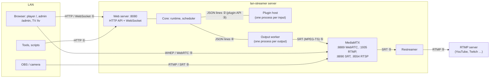

# Interfaces

Every interface of lan-streamer in one place: what talks to what, in which format, and how stable it is. How to *write* a plugin is in the [plugin guide](plugin-guide.md); the internals behind these interfaces in the [architecture](architecture.md).



| # | Interface | Who uses it | Stability |
| --- | --- | --- | --- |
| ① | [HTTP API and WebSocket](#1-http-api-and-websocket) | the pages, scripts, other tools | not versioned yet – may change until lan-streamer 1.0 |
| ② | [Plugin host protocol](#2-plugin-host-protocol) | core ↔ plugin process | internal – plugins never see it |
| ③ | [Plugin API](#3-plugin-api-v1) (`lanstreamer_sdk`) | plugin authors | **stable: API 1**, pinned by contract tests |
| ④ | [Output worker protocol](#4-output-worker-protocol) | core ↔ GStreamer process | internal |
| ⑤ | [Media: streams in and out](#5-media-streams-in-and-out) | browsers, OBS, cameras, RTMP servers | ports and paths stable |
| ⑥ | [Files and folders](#6-files-and-folders) | admins, installers, backups | stable locations |

---

## 1. HTTP API and WebSocket

Served on port **8080** (option `--port`). JSON in and out. Interactive documentation of every endpoint with its schema: **`http://<server>:8080/api/docs`**.

Errors come as `{"detail": "…"}` with the usual status codes: `401` login required / wrong password, `404` unknown output, input or plugin, `409` not allowed in this state (e.g. removing the last output), `422` invalid input (the plugin's validation errors as `{"detail": {"message", "errors": [{"field", "message"}]}}`), `503` not running yet or the plugin could not answer.

Most endpoints take `?output=<id>`; without it they mean the first output.

### Public (everyone in the LAN)

| Method and path | Answer |
| --- | --- |
| `GET /` | player page |
| `GET /admin` | admin page |
| `GET /tv`, `GET /tv/<output>` | only the stream, full window (TV, kiosk) |
| `GET /api/status?output=` | status of an output (below) |
| `WS /api/ws?output=` | the same status, pushed on every change and at least once a second; closes with code 4404 when the output is removed |
| `GET /api/viewer?output=` | the viewer forms of the output's inputs with their items (below) |
| `POST /api/viewer/<input>` | send a viewer form: body = the form's fields as JSON → `{"message": "…"}`, or `422` with the plugin's refusal as `detail`. Sets the cookie `lanstreamer_device` (a random id, one year) that identifies the browser for limits per device. |

`GET /api/status` (shortened):

```json
{
  "version": "0.0.1-test.40", "state": "running",
  "output_id": "out1", "output_name": "Output 1",
  "encoder": "nvidia", "resolution": "1920x1080", "target_fps": 60, "fps": 59.9,
  "current": "Short-video submissions",
  "now": {"title": "Funny cat", "channel": "@cats", "submitter": "Anna", "thumbnail": "https://…"},
  "inputs": [
    {"id": "standby", "name": "Standby", "plugin": "standby", "priority": 0, "fallback": true,
     "override": "none", "state": "active", "error": "", "title": "Standby", "info": "", "viewer_form": false},
    {"id": "submissions", "name": "Short-video submissions", "plugin": "submissions", "priority": 50,
     "fallback": false, "override": "none", "state": "on air", "error": "", "title": "Funny cat",
     "info": "2 waiting · yt-dlp 2026.10.21", "viewer_form": true}
  ],
  "switches": 12, "failed_switches": 0, "last_error": "",
  "restream": "off", "debug_clock": false, "whep_port": 8889, "whep_path": "out1",
  "started": 1793038002.6, "uptime_s": 3600, "viewer_version": 7,
  "outputs": [{"id": "out1", "name": "Output 1", "current": "Short-video submissions"}]
}
```

- `state` of the output: `starting`, `running`, `failed`, `stopping`.
- `state` of an input: `on air`, `active`, `inactive`, `cooling down` (its source failed, it sits out 30 s), `error` (the plugin process failed; `error` says why).
- `debug_clock`: the output shows the debug clock; the player page then shows its local clock next to it (the difference is the delay).
- `viewer_version` grows whenever a viewer list changes – reload `/api/viewer` then.
- The player connects to `http(s)://<server>:<whep_port>/<whep_path>/whep` (see [Media](#5-media-streams-in-and-out)).

`GET /api/viewer`:

```json
[{
  "input_id": "submissions", "name": "Short-video submissions", "title": "Submit a video",
  "schema": {"type": "object", "required": ["link"], "properties": {
    "link": {"type": "string", "title": "Link", "description": "TikTok, YouTube Shorts, …", "minLength": 8, "maxLength": 500},
    "name": {"type": "string", "title": "Your name (optional)", "default": "", "maxLength": 32}}},
  "items": [{"id": "efc9d013", "text": "Funny cat", "detail": "by Anna"}]
}]
```

`schema` is the JSON Schema of the plugin's `ViewerForm`, `items` its `viewer_items()`.

### Admin login

One password for the admin; a session cookie `lanstreamer_session` (HTTP-only, SameSite strict, 7 days).

| Method and path | Body → answer |
| --- | --- |
| `GET /api/admin/session` | → `{"password_set": bool, "logged_in": bool}` |
| `POST /api/admin/setup` | `{"password"}` → 204 and logged in; only while no password is set (first start) |
| `POST /api/admin/login` | `{"password"}` → 204, or 401 after a 1 s delay |
| `POST /api/admin/logout` | → 204 |
| `POST /api/admin/password` | `{"current", "new"}` → 204 |

Example with curl:

```
curl -c cookies -X POST http://server:8080/api/admin/login -H "content-type: application/json" -d '{"password": "…"}'
curl -b cookies -X POST "http://server:8080/api/admin/next?output=out1"
```

### Admin (logged in)

| Method and path | Body → answer |
| --- | --- |
| `POST /api/admin/next?output=` | "Next input": the input on air hands over → 204 |
| `GET /api/admin/plugins` | → `[{"id", "name", "version", "description", "schema", "builtin", "requirements", "enabled", "always_on"}]`; `schema` = JSON Schema of the plugin's settings |
| `PUT /api/admin/plugins` | the plugin `.zip` as the request body (max. 50 MB) → 201 `{"id", "name", "version"}`; inputs using it restart |
| `PATCH /api/admin/plugins/<id>` | `{"enabled": bool}` – turn a plugin on/off (not Standby, not while inputs use it) |
| `DELETE /api/admin/plugins/<id>` | remove an uploaded plugin (not built-in, not in use) → 204 |
| `GET /api/admin/outputs` | → outputs with their inputs (below) |
| `POST /api/admin/outputs` | `{"name"}` → 201, the new output (first output's format, a Standby input); starts at once |
| `PATCH /api/admin/outputs/<id>` | any of `name`, `width`, `height`, `fps` (30/60), `bitrate_kbps` (0 = automatic), `encoder` (`auto`, `nvidia`, `amd`, `intel`, `cpu`), `overlay` (`switch`, `always`, `off`), `overlay_s`, `restream_url` (`rtmp(s)://server/app/key`, empty = off), `debug_clock` (bool: the input's name and the time in ms in the top right of the picture, to measure the delay; off by default) → `{"output", "restart_required"}`; format and encoder take effect after a restart |
| `DELETE /api/admin/outputs/<id>` | remove an output and its inputs (not the last one) → 204 |
| `POST /api/admin/outputs/<id>/inputs` | `{"name", "plugin", "settings", "priority" (0–1000, default 10), "fallback", "min_duration_s", "max_duration_s"}` → 201, the input; the settings are validated by the plugin |
| `PUT /api/admin/outputs/<id>/order` | `{"ids": [every input id once]}` – order among equal priorities → 204 |
| `PATCH /api/admin/inputs/<id>` | any of `name`, `settings`, `priority`, `fallback`, `min_duration_s`, `max_duration_s`, `override` (`none`, `force`, `block`) → the input |
| `DELETE /api/admin/inputs/<id>` | → 204 |
| `GET /api/admin/inputs/<id>/items` | → the input's `viewer_items()` |
| `DELETE /api/admin/inputs/<id>/items/<item>` | the plugin's `remove_item()` → 204 |
| `GET /api/admin/update` | → `{"current", "latest", "available", "installable", "how", "notes_url", "checked_at", "state" (idle, checking, downloading, installing), "progress", "error", "auto_check"}` |
| `PATCH /api/admin/update` | `{"auto_check": bool}` – look for new releases on start and twice a day |
| `POST /api/admin/update/check` | look now → the state above |
| `POST /api/admin/update/install` | → 202; downloads the release's Windows installer, checks its SHA-256, starts it silently and ends lan-streamer; the installer starts it again. 409 when there is nothing to install (or not on Windows) |
| `GET /api/admin/local-page` | → `{"mode" (player, fullscreen, off), "modes", "edge", "kiosk_open"}` – what lan-streamer opens on its own PC when it starts (not after an update); 501 without a desktop (Linux service) |
| `PATCH /api/admin/local-page` | `{"mode": "player" \| "fullscreen" \| "off"}` – fullscreen = only the stream (/tv) in Microsoft Edge's kiosk mode, with sound |
| `POST /api/admin/local-page/open` | opens it now as set (a kiosk window opened before is closed first) → the state above plus `"message"` |
| `GET /api/admin/logs/<name>?lines=300` | plain text, the last lines (max. 5000) of `lan-streamer.log`, `output.log`, `output-<id>.log` or `mediamtx.log` |

An output from `GET /api/admin/outputs`:

```json
{"id": "out1", "name": "Output 1", "width": 1920, "height": 1080, "fps": 60, "bitrate_kbps": 0,
 "encoder": "auto", "overlay": "switch", "overlay_s": 8.0, "restream_url": "", "debug_clock": false,
 "inputs": [{"id": "submissions", "name": "Short-video submissions", "plugin": "submissions",
             "settings": {}, "priority": 50, "fallback": false, "min_duration_s": 0.0,
             "max_duration_s": null, "override": "none"}]}
```

Every change is stored at once (SQLite) and taken over by the running output without a restart, except format and encoder.

---

## 2. Plugin host protocol

*Internal – plugin authors use the [plugin API](#3-plugin-api-v1) and never see this protocol. Described here so the system can be understood and debugged.*

The core starts one process per input:

```
python -m lanstreamer.plugins.host --plugin <folder> --instance <input id> --data-dir <folder> --settings '<json>'
python -m lanstreamer.plugins.host --plugin <folder> --check [--settings '<json>']
```

`--check` prints the settings' JSON Schema, the validated settings and the errors, and exits – the admin API validates settings this way, so the core never imports plugin code. In a running process, the two talk in **JSON lines** over the child's stdin/stdout; stderr is the plugin's log.

Plugin process → core (stdout):

| Message | Meaning |
| --- | --- |
| `{"event": "ready", "api_version": 1}` | `start()` has finished |
| `{"event": "active", "value": true}` | from `watch_active()` |
| `{"event": "metadata", "value": {"title", "channel", "thumbnail", "duration_s", "submitter"}}` | `ctx.set_metadata()` |
| `{"event": "next_source"}` | `ctx.next_source()` |
| `{"event": "info", "value": "3 waiting"}` | `ctx.set_info()` |
| `{"event": "changed"}` | `ctx.changed()` |
| `{"event": "fatal", "message": "…"}` | the plugin cannot run (bad settings, import error, crash) |
| `{"id": 7, "result": …}` / `{"id": 7, "error": "…", "rejected": true}` | answer to a call; `rejected` marks a `Rejected` meant for the viewer |

Core → plugin process (stdin):

| Message | Calls |
| --- | --- |
| `{"id": 7, "method": "get_source"}` | `get_source()` → the source as a dict (below) |
| `{"id": 7, "method": "can_release"}` | `can_release()` → bool |
| `{"id": 7, "method": "viewer_schema"}` | → `{"title", "schema"}` of the `ViewerForm`, or `null` |
| `{"id": 7, "method": "viewer_submit", "params": {"form": {…}, "viewer": {"device", "ip"}}}` | validates the form, `on_viewer_submit()` → the message |
| `{"id": 7, "method": "viewer_items"}` | `viewer_items()` → `[{"id", "text", "detail"}]` |
| `{"id": 7, "method": "remove_item", "params": {"id": "…"}}` | `remove_item()` |
| `{"method": "playback", "params": {"kind": "started" \| "ended" \| "failed", "detail": "…"}}` | `on_playback()` |
| `{"method": "stop"}` | `stop()`, then the process ends |

A process that ends is restarted after 2, 5, 15, then 60 s. Time limits per call: see the plugin guide.

---

## 3. Plugin API v1

The interface for plugin authors: the Python package `lanstreamer_sdk`. Full description with examples: **[plugin guide](plugin-guide.md)**; examples: [`examples/`](../examples). In short:

| Part | What |
| --- | --- |
| `plugin.toml` | `id`, `name`, `version`, `api_version = 1`, `entry = "module:Class"`, optional `description`, `requirements` |
| `InputPlugin[Settings]` | hooks `start`, `stop`, `is_active`, `watch_active`, `get_source`, `can_release`, `on_playback`, `on_viewer_submit`, `viewer_items`, `remove_item`; attributes `Settings`, `poll_interval_s`, `ViewerForm`, `viewer_title` |
| Sources | `UriSource(uri, audio_uri)`, `FileSource(path, cut)`, `ImageSource(path)`, `CardSource(title, heading, subtitle)`, `TestSource(pattern, freq)` |
| Data | `Metadata`, `PlaybackEvent`, `Viewer`, `ViewerItem`, `Rejected` |
| Context `self.ctx` | `instance_id`, `data_dir`, `log`, `store`, `set_metadata()`, `next_source()`, `set_info()`, `changed()` |
| Tools | `python -m lanstreamer_sdk check|pack <folder>`, `lanstreamer_sdk.testing.make_context()` |

**Stability:** API 1 only grows – new things come with defaults. A breaking change means API 2, and lan-streamer refuses plugins of an API version it does not provide, at upload, with a clear message. [`tests/test_plugin_contract.py`](../tests/test_plugin_contract.py) pins all of the above in CI.

How a source dict reaches the output worker (`source_to_dict`): `FileSource` becomes `{"kind": "uri", "uri": "file:///…"}` (plus `"cut": true`), `ImageSource` `{"kind": "image", "path"}`, `UriSource` `{"kind": "uri", "uri", "audio_uri"?}`, the others their fields.

---

## 4. Output worker protocol

*Internal.* One GStreamer process per output (`python -m lanstreamer.media.output`), started by the core with the output's format, encoder and the SRT address of MediaMTX. JSON lines again:

| Core → worker (stdin) | |
| --- | --- |
| `{"cmd": "play", "id": "7", "label": "…", "source": {…}}` | start the source in a new slot, fade it in at its first frame (`"cut": true`: replace without fading) |
| `{"cmd": "clear"}` | fade out to the background (black and silence) |
| `{"cmd": "overlay", "title", "subtitle", "duration_s"}` | the lower third; `duration_s` 0 keeps it, an empty title hides it |
| `{"cmd": "debug_clock", "on": true}` | the debug clock in the picture on/off (starts off) |
| `{"cmd": "stop"}` | end |

| Worker → core (stdout) | |
| --- | --- |
| `{"event": "ready"}` | pipeline is running |
| `{"event": "playing", "id", "label"}` | the source is on air → `on_playback("started")` |
| `{"event": "switch_failed", "id", "reason"}` | it never delivered a frame; the old source stays → `"failed"` |
| `{"event": "ended", "id"}` / `{"event": "failed", "id", "reason"}` | the source on air ended / broke → `"ended"` / `"failed"` |
| `{"event": "stats", "fps"}`, `{"event": "stream", "caps"}`, `{"event": "ts_table", …}`, `{"event": "error", "message"}` | for the status and diagnostics |

The pipeline itself never stops while the worker runs: background layer + input slots → compositor/audiomixer → H.264 (constrained baseline) + Opus → MPEG-TS → SRT to MediaMTX.

---

## 5. Media: streams in and out

MediaMTX runs next to lan-streamer with its default ports. The Windows installer (all-users install) allows lan-streamer and MediaMTX through the firewall for private and domain networks; on Linux open the ports yourself if a firewall is active.

| Port | Protocol | Use |
| --- | --- | --- |
| 8080 / TCP | HTTP | pages and API (lan-streamer itself) |
| 8889 / TCP, 8189 / UDP | WebRTC (WHEP) | the player: `POST http://<server>:8889/<output>/whep` with an SDP offer; H.264 + Opus |
| 8890 / UDP | SRT | output workers publish `publish:<output>`; senders publish `publish:ingest/<key>`; readers read `read:<output>` |
| 1935 / TCP | RTMP | senders (OBS) publish to `rtmp://<server>:1935/ingest` with the stream key |
| 8554 / TCP | RTSP | ingest streams are read back from `rtsp://127.0.0.1:8554/ingest/<key>`; outputs are readable as `rtsp://<server>:8554/<output>` (e.g. VLC) |
| 9997 / TCP | HTTP | MediaMTX API, **localhost only** – the ingest input asks it whether a stream arrives |

- **Outputs:** path = output id (`out1`, …). Any WebRTC/WHEP, SRT or RTSP client can watch, not only the player page.
- **Ingest** (built-in input): RTMP server `rtmp://<server>:1935/ingest`, stream key = the input's key; or SRT `srt://<server>:8890?streamid=publish:ingest/<key>`. H.264 or H.265 with AAC or Opus.
- **Restream:** per output an RTMP(S) URL `rtmp(s)://server/app/stream-key`; a separate process reads the output over SRT and sends it on (H.264 as it is, Opus → AAC).

---

## 6. Files and folders

| What | Windows | Linux (package) |
| --- | --- | --- |
| Program | `C:\Program Files\lan-streamer` (or per user) | `/opt/lan-streamer` |
| Data: database `lanstreamer.db`, `logs/`, `plugins/`, `plugin-data/` | `%LOCALAPPDATA%\lan-streamer` | `/var/lib/lan-streamer` (service user `lanstreamer`); started by hand: `~/.local/share/lan-streamer` |
| Installer choices | `<program>\setup.ini` (`[plugins]` `submissions=on` …) | – |

- `lanstreamer.db` (SQLite, versioned schema) holds outputs, inputs, settings and the admin password hash. Back it up with the app stopped.
- `plugins/<id>/` – uploaded plugins (with their `.deps`); `plugin-data/<input id>/` – each input's `ctx.data_dir` and `store.json`.
- `logs/` – `lan-streamer.log` (core, plugins), `output.log` / `output-<id>.log` (GStreamer per output), `mediamtx.log`.
- `updates/` – the last downloaded installer (replaced by the next update).

### Updates

The updater asks GitHub for the latest release (`https://api.github.com/repos/zGLados/lan-streamer/releases/latest`; another address with `LANSTREAMER_UPDATE_FEED`, for tests). It needs internet only for that; without, the admin page says it could not check. Installing, for all users: lan-streamer runs the task "lan-streamer Update" (`schtasks /Run`; SYSTEM, startable by every signed-in user, registered by the installer) and ends; the task's `update-helper.ps1` fetches the release (its address can only be changed by an admin: `HKLM\Software\lan-streamer`, value `UpdateFeed`), checks the installer's SHA-256, runs it with `/VERYSILENT /SUPPRESSMSGBOXES /NORESTART /CLOSEAPPLICATIONS /WAITAPP=1` and writes `<program folder>\updates\result.json` (`ok`, `message`, `version`, `time`) and `install.log`; a relauncher in the user's session waits for that file and starts lan-streamer again, which shows a failure on the admin page. For an install "only for me": lan-streamer downloads and checks the installer itself and runs it with `/LAUNCH=1 [/LAUNCHFPS=30]` (the installer starts lan-streamer again). Both wait until lan-streamer has ended (mutexes `lan-streamer-running`, `Global\lan-streamer-running`).
