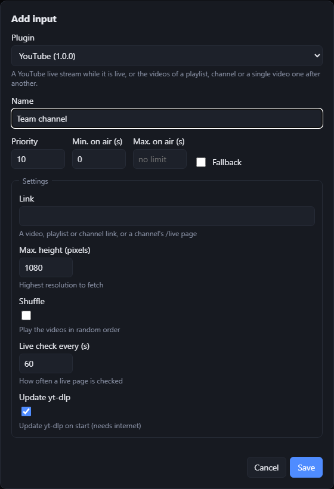

# Writing an input plugin

An input plugin is a source for lan-streamer's channel: a queue of viewer links, a camera, a web service that knows when something is live. lan-streamer decides when it goes on air, decodes and re-encodes what it plays, and shows it in every browser on the LAN. The plugin only answers a few questions:

- **Do I have something to show right now?** (`is_active` / `watch_active`)
- **What should be played when I go on air?** (`get_source`)
- **On equal priority, may another input take over now?** (`can_release`)

Everything else is optional. This guide describes the **plugin API version 1**.

## Contents

1. [Quick start](#quick-start)
2. [The plugin folder](#the-plugin-folder)
3. [How lan-streamer runs a plugin](#how-lan-streamer-runs-a-plugin)
4. [The plugin class](#the-plugin-class)
5. [What a plugin can play](#what-a-plugin-can-play)
6. [Settings](#settings)
7. [Viewer forms](#viewer-forms)
8. [The context: logging, storage, metadata](#the-context-logging-storage-metadata)
9. [Testing](#testing)
10. [Packing and uploading](#packing-and-uploading)
11. [Compatibility](#compatibility)
12. [Troubleshooting](#troubleshooting)

## Quick start

You need Python 3.12+ and git, but no copy of lan-streamer. The SDK is a small package of its own:

```
python -m venv .venv
.venv/bin/pip install "lanstreamer-sdk[test] @ git+https://github.com/zGLados/lan-streamer#subdirectory=packaging/sdk"
                                            # Windows: .venv\Scripts\pip ...; then activate the venv
python -m lanstreamer_sdk new my-plugin     # a working plugin in a new folder; the folder's name is its id
python -m lanstreamer_sdk check my-plugin   # loads it like lan-streamer, shows the forms
python -m pytest my-plugin                  # its tests
python -m lanstreamer_sdk pack my-plugin    # → my-plugin-0.1.0.zip
```

Upload the zip in the admin page (Plugins → Upload), then add an input with it (Inputs → Add input). It plays a test picture; now replace `is_active()` and `get_source()` in `my_plugin.py` with your source.

### Learning from the examples

There are three examples in [`examples/`](../examples) (overview: [examples/README.md](../examples/README.md)); every interface of lan-streamer is described in [interfaces.md](interfaces.md).

| Example | Shows |
| --- | --- |
| [`hello-plugin`](../examples/hello-plugin) | The smallest useful plugin: a test picture that is active during the first seconds of every minute. |
| [`web-stream`](../examples/web-stream) | The usual case: an external live stream (camera, service, server) that is on air while it is online; network checks off the event loop, title from a JSON status URL. With its own tests. |
| [`stream-queue`](../examples/stream-queue) | Every part of the API: viewers queue links to videos or streams, they play one after another. With its own tests. Copy it as a template. |

To build on an example instead of the new plugin: copy `web-stream` for a source that is live now and then, or `stream-queue` for things viewers send in. Then, in `plugin.toml`, change `id`, `name` and `entry`, and rename the `.py` file to match `entry`.

## The plugin folder

```
my-plugin/
  plugin.toml        the manifest
  my_plugin.py       the module named in `entry` (more modules and files are fine; end its name
                     in `_plugin` or similar, so it cannot shadow a package you import)
  tests/             your tests – not packed into the upload
```

`plugin.toml`:

```toml
id = "my-plugin"           # unique; 2–49 characters: a-z, 0-9 and "-"
name = "My plugin"         # shown in the admin page
version = "1.0.0"          # your plugin's version
api_version = 1            # the plugin API it is written for
entry = "my_plugin:Plugin" # module:Class
description = "One sentence for the admin page."  # optional
requirements = ["requests>=2.32"]                   # optional: packages from PyPI
```

| Key | Required | Meaning |
| --- | --- | --- |
| `id` | yes | Identifies the plugin. Uploading a zip with the same id replaces the old version. Built-in ids (`standby`, `playlist`, `submissions`, `youtube`, `ingest`, `test-pattern`) cannot be used. |
| `name` | yes | Display name. |
| `version` | yes | Free text; shown in the admin page. |
| `api_version` | yes | Must be `1`. A lan-streamer that does not provide this API version refuses the plugin with a clear message. |
| `entry` | yes | `module:Class`; the class must derive from `InputPlugin`. The plugin folder is on the import path. |
| `description` | no | Shown in the admin page. |
| `requirements` | no | Installed with pip at upload into the plugin's own `.deps` folder, so plugins cannot break each other's packages. The server needs internet access only at that moment. |

Unknown keys are ignored.

**Python:** plugins run on the Python that comes with lan-streamer – 3.13 on Windows (installer), the distribution's 3.12+ on Linux. Write for 3.12. Already there: the standard library, `pydantic` 2 and `lanstreamer_sdk`. Everything else goes into `requirements`. Packages with compiled parts need wheels for that Python and system (Windows x64, Linux x86-64).

## How lan-streamer runs a plugin

- **One process per input.** Each input created with your plugin runs in its own plugin host process with its own settings and data folder. Two inputs of the same plugin share nothing but the code. A crash only takes the input down; lan-streamer shows it as an error and restarts it after 2, 5, 15, then 60 seconds.
- **asyncio.** All hooks are `async` and run on the event loop of that process. Never block it: use `await asyncio.sleep()`, an async library, or `await asyncio.to_thread(blocking_call)` for blocking work (file downloads, a synchronous HTTP client, yt-dlp).
- **stdout belongs to lan-streamer.** It is the channel between the core and the plugin process. `print()` and other output to stdout are redirected to the log, but use `self.ctx.log`.
- **Timeouts.** `get_source()` has 30 s, `can_release()` 5 s, `viewer_items()` and `remove_item()` 10 s, `on_viewer_submit()` 60 s. A call that takes longer counts as failed.

### When does an input go on air?

Each output has its own list of inputs with a priority (set by the admin). The scheduler puts on air the active input with the highest priority:

1. A **higher** priority interrupts at once.
2. On **equal** priority the input on air keeps going until its minimum duration is over **and** its `can_release()` returns true – or until its maximum duration is reached. Then the next active input of that priority follows.
3. Nothing active: the fallback input (Standby picture).

Activity changes must hold for 1 s before they count (except the first report after the start), so a flapping source does not cause switching back and forth. The admin can also force or block an input.

### The life of a source

```
get_source() ─► on_playback("started") ─► … ─► on_playback("ended")   the source ran out
                                         └─► on_playback("failed")  it could not be played or broke
```

- After **"ended"** the input usually wants to show its next item: call `ctx.next_source()`. If the input is still the one to be on air, lan-streamer calls `get_source()` again at once (an input of the same priority whose `can_release()` turn has come may take over instead). If there is nothing left, report the input inactive.
- After **"failed"** – or when `get_source()` raises – the input sits out for 30 s before it is tried again.
- When a higher priority interrupts, there is **no** event. When the input returns, `get_source()` is called again, so return what should play *then* (e.g. the same queue entry from the start, or the live stream as it is now).
- Images and cards never end by themselves: the plugin decides how long they stay (e.g. the playlist's image duration: a timer, then `ctx.next_source()`).

## The plugin class

```python
from pydantic import BaseModel, Field
from lanstreamer_sdk import InputPlugin, UriSource


class Settings(BaseModel):
    url: str = Field(description="HLS address of the camera")


class Plugin(InputPlugin[Settings]):
    Settings = Settings

    async def is_active(self) -> bool:
        return await camera_is_online(self.settings.url)

    async def get_source(self):
        return UriSource(self.settings.url)
```

Hooks – override what you need:

| Hook | Default | Called |
| --- | --- | --- |
| `async start()` | nothing | once after the instance was created, before anything else; set up state here |
| `async stop()` | nothing | once before the process ends (input removed or changed, lan-streamer stops) |
| `async is_active() -> bool` | `True` | by the default `watch_active()` every `poll_interval_s` |
| `async watch_active()` | polls `is_active()` | an async generator; yields `True`/`False` whenever the activity changes. Override it to report changes at once (see `stream-queue`) |
| `async get_source() -> MediaSource` | **required** | when the input goes on air or asked for its next item; raise an exception if there is nothing to play |
| `async can_release() -> bool` | `True` | while on air, about once a second, when an input of the same priority waits |
| `async on_playback(event)` | nothing | `event.kind` is `"started"`, `"ended"` or `"failed"` (`event.detail`: the reason) |
| `async on_viewer_submit(form, viewer) -> str` | refuses | a viewer sent the `ViewerForm`; see [Viewer forms](#viewer-forms) |
| `async viewer_items() -> list[ViewerItem]` | `[]` | the lines under the form on the player page (e.g. a queue) |
| `async remove_item(item_id)` | nothing | the admin removed one of the `viewer_items()` |

Class attributes:

| Attribute | Default | Meaning |
| --- | --- | --- |
| `Settings` | `NoSettings` | the settings model (Pydantic) |
| `poll_interval_s` | `5.0` | how often the default `watch_active()` calls `is_active()` |
| `ViewerForm` | `None` | a Pydantic model for a form on the player page |
| `viewer_title` | `""` | heading of the form and its list |

`self.settings` is the validated settings object, `self.ctx` the [context](#the-context-logging-storage-metadata). Keep `__init__` as it is – set up in `start()`.

## What a plugin can play

`get_source()` returns one of these (all in `lanstreamer_sdk`):

| Source | Plays |
| --- | --- |
| `UriSource(uri, audio_uri="")` | anything GStreamer opens by URI: `http(s)://` MP4/WebM/MKV/HLS (`.m3u8`)/DASH, `rtsp://`, `srt://`, `file:///`. With `audio_uri` the picture comes from `uri` and the sound from `audio_uri` (e.g. YouTube's separate HD streams). |
| `FileSource(path, cut=False)` | a local media file. `cut=True` switches to it without the 1 s crossfade, so nothing of its start is lost. |
| `ImageSource(path)` | a PNG or JPEG with silence; never ends by itself. |
| `CardSource(title, heading="", subtitle="")` | a dark card with text and silence (e.g. "Up next" / title / "by Anna"); never ends by itself. |
| `TestSource(pattern="smpte", freq=440)` | a generated test picture with a tone; `pattern` is any GStreamer `videotestsrc` pattern. |

Every source is scaled to the output's format (1080p, 60 or 30 fps) and switched to with a crossfade. Live sources that stall are retried by lan-streamer itself; when they cannot recover, the plugin gets `"failed"`.

**Formats** lan-streamer can decode on every platform: video H.264, H.265, VP8, VP9, AV1; audio AAC, MP3, Opus, Vorbis; containers MP4/MOV, MKV/WebM, MPEG-TS, HLS, DASH; RTSP (H.264/H.265/AAC/Opus) and SRT (MPEG-TS). For other formats return a URL of a different rendition, or convert in the plugin. Prefer H.264 + AAC: it is the cheapest to decode.

URLs that expire (signed CDN links) should be resolved in `get_source()`, right before they are played – not in `start()`.

## Settings

The settings are a Pydantic model; the admin page builds the form from its JSON Schema (here the built-in YouTube input):



```python
class Settings(BaseModel):
    url: str = Field(description="Address of the stream")           # text field
    quality: Literal["720p", "1080p"] = "1080p"                     # drop-down
    check_s: float = Field(10, ge=2, le=300, description="Check every … seconds")  # number with limits
    shuffle: bool = False                                           # check box
    channels: list[str] = Field(default_factory=list)               # one entry per line
```

- `title` is the label (without it the field name is used, e.g. "Live Check S"), `description` is shown under the field. Give every field a default when you can – the admin then only fills in what matters.
- Enumerations (`Literal`, `Enum`) become a drop-down, numbers with `ge`/`le` get limits, `bool` a check box, `list[str]` a text box with one entry per line; anything else is edited as JSON.
- The admin page validates the input in a short-lived plugin process before storing it, so your validators (`field_validator`, …) run and their messages are shown.
- When the settings change, the input's process is restarted with the new settings.
- Settings are visible to every admin and stored in plain text. Fine for API keys of LAN services; tell the admin in the description if a field holds a secret.

## Viewer forms

A plugin can put a form on the player page – a link to submit, a vote, a wish:

```python
class Wish(BaseModel):
    url: str = Field(title="Link", description="A video link")
    name: str = Field("", max_length=40, title="Your name (optional)")


class Plugin(InputPlugin[Settings]):
    ViewerForm = Wish
    viewer_title = "Wish a video"

    async def on_viewer_submit(self, form: Wish, viewer: Viewer) -> str:
        if not form.url.startswith("https://"):
            raise Rejected("Please send an https link.")
        self.queue.append(...)
        self.ctx.changed()                 # the pages reload viewer_items()
        return "Thanks – it is in the queue."

    async def viewer_items(self) -> list[ViewerItem]:
        return [ViewerItem(id=w.id, text=w.title, detail=f"by {w.name}") for w in self.queue]

    async def remove_item(self, item_id: str) -> None:
        self.queue = [w for w in self.queue if w.id != item_id]
        self.ctx.changed()
```

- Fields: `title` is the label, `description` the hint inside the empty field, `max_length` limits the input; text, numbers, check boxes (`bool`) and drop-downs (`Literal`) work. A field whose name contains "name" is filled with the name the viewer used last; one whose name contains "url" or "link" is a URL field.
- The form is validated against the model before `on_viewer_submit()` is called; validation errors go back to the viewer as they are.
- Return a short message for the viewer, or `raise Rejected("…")` – its text is shown as it is, so write it for viewers.
- `viewer` identifies the sender: `viewer.device` is a long-lived id of the browser (cookie), `viewer.ip` the LAN address. Use it for limits per device. It is not an authentication – anyone in the LAN can open the page.
- `viewer_items()` lists lines under the form (e.g. the queue); the admin page lists them too and can remove them (`remove_item()`). Call `ctx.changed()` whenever they change.
- The form shows on the player page of the output the input belongs to.

## The context: logging, storage, metadata

`self.ctx` (a `PluginContext`) gives every input:

| | |
| --- | --- |
| `ctx.instance_id` | the input's id |
| `ctx.data_dir` | a folder of its own that survives restarts and updates of the plugin (e.g. downloaded files) |
| `ctx.log` | a `logging.Logger`; goes to lan-streamer's log, prefixed with the input's id |
| `ctx.store` | a small persistent key-value store (`get(key, default)`, `set(key, value)`); values must be JSON-serialisable; every `set()` writes the file |
| `ctx.set_metadata(Metadata(...))` | what is playing: `title`, `channel`, `thumbnail` (URL), `duration_s`, `submitter`. Shown on the player page and in the lower-third overlay. Call it in `get_source()` or when a live stream's title changes. |
| `ctx.next_source()` | "my item ended, play my next one" – see [The life of a source](#the-life-of-a-source) |
| `ctx.set_info("3 waiting")` | a short status line next to the input in the admin page |
| `ctx.changed()` | `viewer_items()` changed; the pages reload them |

## Testing

**Unit tests without lan-streamer running.** `lanstreamer_sdk.testing.make_context()` gives a context with its own data folder that records what the plugin publishes:

```python
import asyncio
from lanstreamer_sdk import PlaybackEvent
from lanstreamer_sdk.testing import make_context
from my_plugin import Plugin, Settings


def test_next_item_after_the_end(tmp_path):
    async def steps():
        ctx, seen = make_context(tmp_path)
        plugin = Plugin(ctx, Settings(url="https://example.org/a.m3u8"))
        await plugin.start()
        source = await plugin.get_source()
        await plugin.on_playback(PlaybackEvent("ended"))
        assert seen.next_requests == 1
        assert seen.metadata[-1].title == "…"

    asyncio.run(steps())
```

`seen` has `metadata`, `info` (lists, oldest first), `next_requests` and `changes` (counts). A `tests/conftest.py` that puts the plugin folder on `sys.path` lets the tests import the plugin module as lan-streamer does – see `examples/stream-queue/tests/`.

**The plugin as lan-streamer loads it.** `python -m lanstreamer_sdk check my-plugin [--settings '{"url": "…"}']` checks the manifest, imports the plugin class and prints the settings form, the validated settings (or the errors) and the viewer form. It exits with 0 (fine), 1 (invalid settings) or 2 (the plugin cannot be loaded).

**The whole thing.** In a clone of lan-streamer (`pip install -e ".[dev]"`), `python -m lanstreamer --simulate` runs the web server, admin page, scheduler and plugin processes for real, without video (the player stays black, the admin page shows what is on air). Upload the plugin there, add an input, submit viewer forms, watch the log (admin page → Logs). For real playback use an installed lan-streamer.

## Packing and uploading

```
python -m lanstreamer_sdk pack my-plugin [-o my-plugin.zip]
```

writes `<id>-<version>.zip` next to the folder, with `plugin.toml` at the top, without `tests/`, `__pycache__`, `.deps` and other zips. A zip made by hand works too: `plugin.toml` at the top of the zip or inside exactly one folder.

At upload (admin page → Plugins → Upload) lan-streamer checks the zip (at most 50 MB, 200 MB unpacked, no paths outside the folder), the manifest and the API version, installs the `requirements`, loads the plugin once in a plugin process, and only then replaces an older version. Inputs that use the plugin restart with the new code. On Windows a running plugin's files can be locked; if the upload says so, block its inputs for a moment and upload again.

**Security:** a plugin is code that runs on the server with lan-streamer's rights – the process isolation protects against crashes, not against malicious code. Only admins can upload, and lan-streamer is meant for a LAN or VPN. Install only plugins you trust.

## Compatibility

- `api_version = 1` is a promise in both directions: lan-streamer keeps everything this guide describes working for API 1 plugins. The SDK names, hook signatures, source types, fields and defaults, manifest keys and the behaviour of a plugin process are pinned by contract tests that run in CI on every change ([`tests/test_plugin_contract.py`](../tests/test_plugin_contract.py)).
- **Within API 1 only additions happen:** new optional hooks with a default, new optional fields, new source types, new optional manifest keys. A plugin that uses an addition should say which lan-streamer it needs in its description – older versions ignore unknown manifest keys but do not know new hooks or types.
- **A breaking change means API 2.** Plugins declare the version they were written for; a lan-streamer that cannot run it refuses it at upload with a clear message, instead of failing later.
- Use only what `lanstreamer_sdk` exports (`lanstreamer_sdk.__all__`, plus `lanstreamer_sdk.testing` in tests). Everything in the `lanstreamer` package is internal and can change at any time.

## Troubleshooting

| Symptom | Look at |
| --- | --- |
| Upload refused | The message names the problem (manifest key, API version, import error, pip output). `python -m lanstreamer_sdk check` shows the same locally. |
| Input shows "error" | Admin page → Logs: the plugin's exception with traceback, prefixed with the input's id. |
| Input never goes on air | Is it active (admin page, state column)? Is another input of higher priority active, or is it blocked? After a failed source it sits out 30 s. |
| Input stays on air after its video ended | Call `ctx.next_source()` after `"ended"`, or report the input inactive when there is nothing left. |
| An input of the same priority never gets its turn | `can_release()` must return `True` at some point (or the admin sets a maximum duration). |
| Viewer form missing | `ViewerForm` set on the class? The input must belong to the output the player page shows. |
| `get_source()` "timed out" | Blocking code on the event loop – move it to `asyncio.to_thread()`. |
